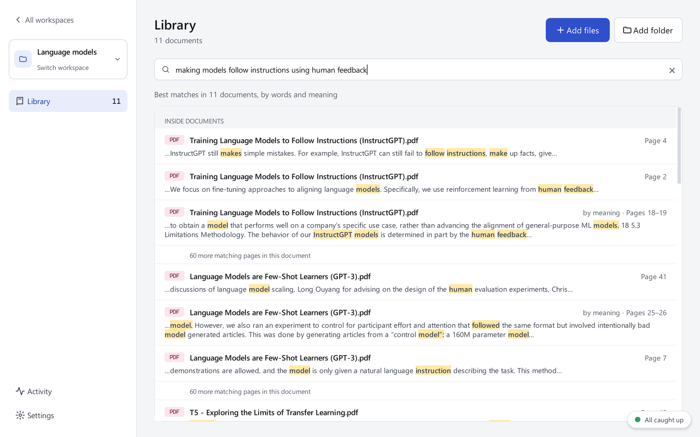

<div align="center">

# Loci

**A private knowledge bank for everything you read.**

Import your papers, books and notes once. Find anything in them by words or
by meaning, and jump straight to the page. Everything stays on your computer.

[](https://github.com/AzureSky0/Local-Research-Assistant-and-Study-Buddy-Hybrid/releases/latest)
[](#download)
[](LICENSE)
[](#status-and-roadmap)

[**Download**](https://github.com/AzureSky0/Local-Research-Assistant-and-Study-Buddy-Hybrid/releases/latest) ·
[**Project overview (PDF)**](docs/showcase/Loci-overview.pdf) ·
[**Roadmap**](docs/team/ROADMAP.md)

<br>



</div>

---

## Why Loci

Students and researchers work through hundreds of documents. Finding the
one page you need means searching file by file, or re-uploading the same
files to online AI tools that forget everything between sessions and keep
your documents on their servers.

Loci keeps your whole collection searchable **on your own computer**, and
every result shows **the page it came from**.

## Features

- **Workspaces:** one collection per course, project or book, so subjects
  never mix.
- **Add files or whole folders:** PDF, plain text and Markdown. Duplicates
  are detected.
- **Search by words:** instant, with the matching passage highlighted and
  its page number.
- **Search by meaning:** finds passages that say the same thing in other
  words, using a small AI model that runs locally.
- **Open at the page:** go from a result straight to that page in your PDF
  viewer.
- **Works in the background:** keep working while documents are read, with
  progress and time left. It resumes after a restart and pauses itself when
  memory runs low.
- **Private by design:** no account, no uploads, no tracking. After a
  one-time model download, it works offline.

Tested on 358 research papers (about 10,000 pages): the right paper appears
in the top five results for **87%** of test questions.

## Download

**Windows 10 or 11** · about 1 GB of free disk space · 8 GB RAM or more

1. Download `Loci-<version>-windows.zip` from the
   [latest release](https://github.com/AzureSky0/Local-Research-Assistant-and-Study-Buddy-Hybrid/releases/latest).
2. Extract the zip and open `Loci.exe`.
3. Windows may show *"Windows protected your PC"* because the app is not
   signed yet: choose **More info → Run anyway**.

Be online the first time: Loci downloads its search model (about 90 MB)
once. Your documents are read where they are; Loci never changes, copies or
uploads them.

## Status and roadmap

Loci is in **early testing** (version 0.3). The document library and search
are complete; we are collecting feedback from first testers.

| Version | Focus | |
|---|---|---|
| 0.3 | Workspaces, import, search by words and meaning | ✅ Available |
| 0.4 | **Ask:** answers from your documents, every claim cited to a page, using a local AI model | Next |
| 0.5 | First public prototype: summaries and polish | Planned |
| 0.6+ | Study tools (flashcards, quizzes, exam-paper analysis) and optional extensions (scanned PDFs, more file types, subject tools) | Planned |

See the full [roadmap](docs/team/ROADMAP.md).

## Run from source

Requires Python 3.12.

```powershell
git clone https://github.com/AzureSky0/Local-Research-Assistant-and-Study-Buddy-Hybrid.git
cd Local-Research-Assistant-and-Study-Buddy-Hybrid
python -m venv .venv
.venv\Scripts\activate
pip install -r requirements.txt
python -m main
```

Run the tests with `pytest`. Built with PySide6 (Qt), SQLite with FTS5 and
sqlite-vec, and fastembed (ONNX). The [team handbook](docs/team/README.md)
covers the architecture, development guide, decisions and release process.

## Contributing

Feedback from testers is the most helpful contribution right now: please
[open an issue](https://github.com/AzureSky0/Local-Research-Assistant-and-Study-Buddy-Hybrid/issues)
describing what you tried and what happened. Extension support (language
packs and other add-ons) is planned, with a guide for extension authors.

Please report security problems privately rather than in a public issue.

## Licence

Loci is free software under the [GNU Affero General Public License v3.0](LICENSE).
Extensions that use only Loci's public extension interface may use any
licence ([extension exception](LICENSE-EXTENSION-EXCEPTION.md)). Bundled
third-party components keep their own licences
([notices](THIRD_PARTY_NOTICES.md)). For other licensing terms, please open
an issue.

Copyright © 2026 Akshat Manojkumar Sahu. *Loci* is a working name.
